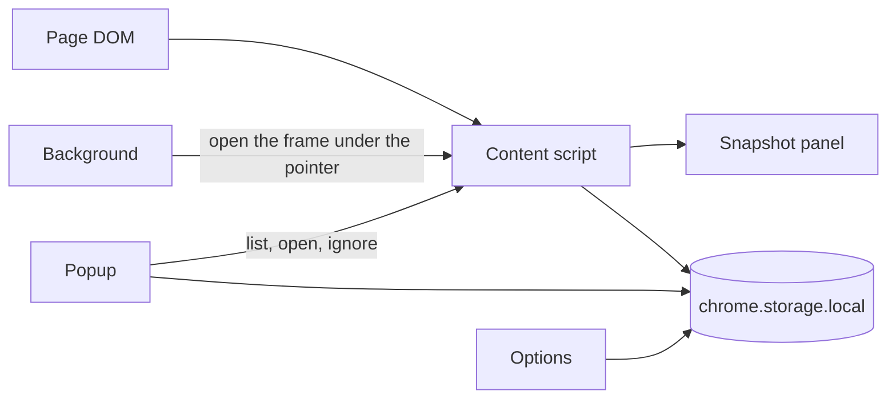

# Architecture

ilovetables is one Manifest V3 extension for Chrome and Firefox. On an `http` or `https` page it finds data tables, marks each one with an icon, and opens a read-only snapshot. The page’s own table is never rewritten. Nothing is uploaded.

This file is the current shape of the system. It is not a changelog. Decisions, including ones that were rejected, are in [docs/adr](docs/adr/).

## Pieces

| Piece | Where | What it does |
| --- | --- | --- |
| Content script | `src/content/` | Runs in every frame. Scans the page, draws the icon and the panel in an open shadow host (`#ilovetables-root`), and answers messages. |
| Shared logic | `src/shared/` | Turns a table into a string matrix, parses values, filters, and builds CSV, Markdown, and clipboard text. No widgets. |
| Background | `src/background.ts` | Adds the right-click command and sends it to the frame that was clicked. |
| Popup | `src/popup/` | Lists tables in the top frame. Ignores one table, this page, this host, or this domain, and shows a hidden table again. |
| Options | `src/options/` | Formula guard, CSV separator, fuzzy search, and the list of ignored tables, pages, hosts, and domains. |

The popup talks to the top frame only. A table inside an iframe is opened from the right-click menu, which passes that frame’s id.

## From the page to the panel

1. A mutation observer watches the document and any open shadow root. Text edits inside a table that is already on the page do not rescan; Refresh does.
2. Each `<table>` and each `role="table"`, `role="grid"`, or `role="treegrid"` becomes a rectangle of strings. Spanned text is repeated. A nested table stays its own grid. Closed shadow roots, canvas, PDF, images, and unroled div layouts are ignored.
3. Layout tables are dropped: navigation and footer chrome, presentation roles, tiny tables, mostly empty tables, and headerless grids that are almost entirely single links. A real header keeps a table even when the cells are links.
4. Each kept table gets an icon in the extension shadow. The icon sits on that table, stays inside its bounds, and scrolls with the page. Hover names the action and blinks a rectangle over the table. The page element is not restyled.
5. A click copies the matrix into the panel. Sorting, fuzzy search, and export run on that copy. The panel grid is virtualized and read-only. Refresh reads the live DOM again. While the panel is open it can be dragged and resized; that frame lasts until it closes.

Header detection prefers `<thead>` or an all-`<th>` first row. Otherwise it guesses one header row only on a strong label-over-values signal. When it guesses none, the panel can mark the first row as the column names.

## Export

The panel exports the filtered, sorted view. “Export all rows” drops the filter and keeps the sort.

Copy as and Save as are split buttons. The label runs the remembered format. The opener picks Markdown or CSV, stores that choice, and runs it. Defaults are Markdown for copy and CSV for save. A cell selection copied with Cmd-C or Ctrl-C is tab-separated, separate from those two buttons.

CSV is RFC 4180 text with CRLF. A saved file starts with a UTF-8 BOM; a clipboard copy does not. Markdown is a GitHub-flavored table. Files are saved with an object-URL link. There is no downloads permission.

## What is stored

Everything stays in `chrome.storage.local` on this browser.

- One settings object for all sites: formula guard, CSV separator, fuzzy search, the Copy as / Save as defaults, and ignore rules for a page URL, a host, or a registrable domain.
- One memory record per host, keyed by the table’s suggested headers: ignored, header-row override, column-type override, and whether to open that table once when the page loads.

A page, host, or domain rule hides every icon on the pages it covers. A table rule hides that one grid on its host. The options page lists both and can remove them. An ignored page can still be opened from the right-click command.

The icon’s dragged position lasts for the page session only.

## Language

Panel, popup, options, and the right-click command take their strings from the English, German, and Czech catalogs in `src/shared/i18n.ts`. The catalog follows the browser UI language, then `navigator.language`, then English. The extension name, description, and toolbar tooltip are the three `_locales` messages, and those three match the catalog. The product name is ilovetables in every language.

## Build

`build.mjs` bundles the four entry points with esbuild as IIFE scripts for Chrome 120 and Firefox 128, copies the manifest, locales, and extension pages into `dist/`, and draws the toolbar icons. `dist/` is generated. The content script must stay under 80 KB gzipped. Extension pages cannot use top-level await.

Tests import `src/` under Node. They do not load the fixture’s script, so open-shadow and late-added rows are checked in the browser, not in the unit tests.

## Boundaries

The extension does not rewrite the host table, edit cells back into the page, fetch, upload, or phone home. It does not read a virtualized grid by scrolling the page. It does not open XLSX, and it does not use a model to find or interpret tables. Detection and parsing are deterministic.

Those boundaries, and the alternatives that were turned down, are recorded in [docs/adr](docs/adr/).
